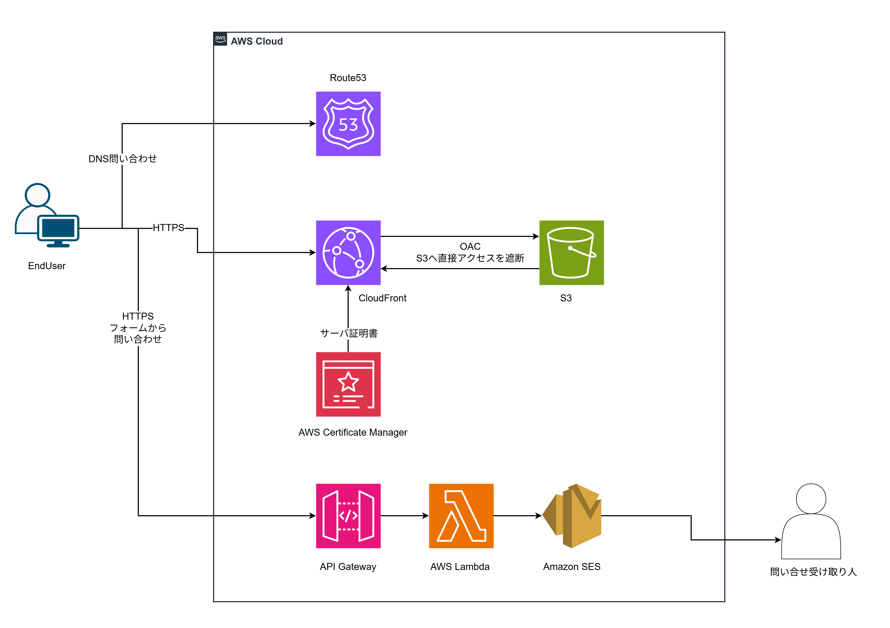

# portfolio-AWS-IaC

個人のポートフォリオサイト [tonooka-tech.com](https://tonooka-tech.com/) の AWS 環境を構築した CloudFormation テンプレートです。
就職活動用に個人で制作したもので、実務の案件ではありません。

サイト側での説明（課題・設計判断・構築結果）は [Projects：ポートフォリオ用Webサイト](https://tonooka-tech.com/html/projects/portfolio-site.html) にあります。

---

## 構成

役割と変更頻度が違うため、スタックを2つに分けています。リージョンは両方とも us-east-1 です。

| スタック | テンプレート | 役割 | 主なリソース |
| :--- | :--- | :--- | :--- |
| `portfolio-hosting` | [`hosting.yaml`](hosting.yaml) | 静的サイトの配信 | ACM / S3 / CloudFront（OAC・CloudFront Functions）/ Route 53 レコード |
| `portfolio-form` | [`form.yaml`](form.yaml) | お問い合わせフォーム | API Gateway（HTTP API）/ Lambda（Python）/ SES / IAM / CloudWatch Logs |

### `portfolio-hosting`

- S3 は非公開にし、CloudFront の OAC からのみ読み取れるようにしている
- `www` 付きのアクセスは、CloudFront Functions で `www` なしへ 301 リダイレクトする
- HTTP は HTTPS へリダイレクトし、AWS のマネージドポリシーでセキュリティヘッダー（HSTS など）を付ける
- 存在しないパスで S3 が返す 403 は、CloudFront で 404 ページ（ステータス 404）に読み替える

### `portfolio-form`

- フォームは JavaScript を使わない素の POST で送信し、Lambda が 302 で送信完了ページ／エラーページへリダイレクトする（CORS なし）
- スパム対策として、API Gateway のスロットリング、`Origin` ヘッダーの確認、ハニーポット（人には見えない入力欄）を組み合わせている
- Lambda はブラウザ側と同じ入力チェックをサーバー側でも行い、メールのヘッダーに入る値から改行文字を取り除く
- Lambda の実行ロールは、ロググループへの書き込みと、決まった送信元アドレスでの SES 送信のみに絞っている
- Lambda のコードは数十行で外部ライブラリを使わないため、テンプレートの `ZipFile` に直接書いている

---

## 主な設計判断

| 採用 | 採用しなかった案と理由 |
| :--- | :--- |
| CloudFormation | Terraform：AWS しか使わず、ステートファイルを自分で管理する手間とリスクが増える。CDK：この規模では抽象化の利点が小さい |
| スタックを2つに分割 | 単一スタック：フォームの変更・削除がサイトの表示に影響しうる |
| スタック間の受け渡しはパラメータ | `Export` / `ImportValue`：参照される側のスタックを更新・削除できなくなる |
| 全リソースを us-east-1 に配置 | 東京＋証明書だけ us-east-1：スタックがリージョンをまたぎ、受け渡しが増える |
| HTTP API → Lambda → SES | REST API から SES を直接呼ぶ：入力チェックを VTL で書くことになり保守しにくく、料金も高い |
| 反映はコンソールから手動で行い、アクセスキーを作らない | AWS CLI＋アクセスキー：公開するリポジトリで作業するため、長期間有効なキーを手元に置かない |

---

## ファイル

| パス | 内容 |
| :--- | :--- |
| `hosting.yaml` | `portfolio-hosting` スタックのテンプレート |
| `form.yaml` | `portfolio-form` スタックのテンプレート（Lambda のコードを含む） |
| `params.example.json` | パラメータの記入例（実際の値は含まない） |
---

## デプロイ

テンプレートの反映は、AWS CLI を使わずに CloudFormation のコンソールから行っています

1. 事前に Route 53 にパブリックホストゾーンを作成し、ドメインの委任を済ませておく（テンプレートの範囲外）
2. `params.example.json` を参考に、ドメイン名・ホストゾーン ID などの値を用意する
3. `cfn-lint hosting.yaml form.yaml` でテンプレートをチェックする
4. コンソール（us-east-1）で `hosting.yaml` から `portfolio-hosting` を作成する
5. 同じく `form.yaml` から `portfolio-form` を作成し、SES の受け取り先アドレスの確認メールを承認する
6. `portfolio-form` の出力 `ApiEndpoint` を、サイトのフォームの送信先（`<form>` の `action`）に設定する

| スタック | パラメータ | 内容 |
| :--- | :--- | :--- |
| 両方 | `DomainName` | サイトのドメイン（`www` なし） |
| 両方 | `HostedZoneId` | `DomainName` のパブリックホストゾーン ID |
| `portfolio-form` | `RecipientEmail` | 問い合わせの受け取り先のメールアドレス |
| `portfolio-form` | `SenderLocalPart` | 送信元アドレスの `@` より前（既定値 `noreply`） |
| `portfolio-form` | `ThanksPath` / `ErrorPath` | 送信完了ページ・エラーページのパス |

月額の費用は約 0.5〜1 USD の見込みです（大半は Route 53 のホストゾーン）。